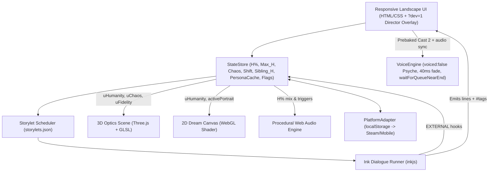

# ARCHITECTURE.md — Pure HTML Engine, Data & Harness Contract

## 1. Architectural Invariants
1. **Pure Static HTML Through Phase 5:** `npm run build` outputs a self-contained static `dist/` bundle runnable in any modern desktop or mobile browser. No Electron or Capacitor dependencies until Phase 6.
2. **Engine vs. Content Isolation:**
   * `src/engine/` — Pure TypeScript systems (Three.js optics, 2D shader canvas, Ink runtime, Storylet scheduler, Web Audio, UI shell, `?dev=1` Director Overlay). Contains **zero** hardcoded narrative prose or balance magic numbers.
   * `src/content/` — Pure data (`balance.json`, `shifts.json`, `characters.json`, `storylets.json`, `anomalies.json`, `dialogue/*.ink`).
   * `src/platform/PlatformAdapter.ts` — Thin ~20-line boundary for persistence (`localStorage` → Steam Cloud/File), achievements (no-op → `steamworks.js`), haptics (no-op → Capacitor), and fullscreen/quit.

## 2. Core Runtime Modules

* **Dialogue & Choice Contract (`DialogueRunner.ts`, `DialogueFeedView.ts`, `VoiceEngine.ts`):**
  * Choices carry structured metadata from Ink tags: `weight` (`explore` | `consequential` | `permanent`), `kind` (`ask` | `reply` | `action` | `prune`), and `costHint` (`# hint:...`), driving color-coded choice plates without exposing Warm/Cold spoiler dots.
  * `VoiceEngine` reads `voice_profiles.json` (`voiced: false` skips unvoiced Psyche marginalia), prefetches audio before engaging `-6 dB` music ducking, applies `40ms` clip fade-outs on `stop()`, inserts `220ms`/`420ms` inter-line pauses, and exposes `waitForQueueNearEnd()` for audio-synced Overseer interrupts.

## 3. State Schema (`StateStore`)
Core serializable state persisted automatically between beats:
* `shift: number` (`0` = Prologue, `1..6` = Shifts, `7` = Finale)
* `mode: 'boot' | 'waking_3d' | 'dream_2d' | 'ending'`
* `humanity: number` (starts `70`, clamped `[0, maxHumanity]`)
* `maxHumanity: number` (starts `90`, permanently reduced on every prune below `70`)
* `chaosDrift: number` (`0..100`)
* `subjectiveMonthsLeft: number` (starts `~24`)
* `opticalFidelity: number` (scales lensing/arc clarity)
* `anomalyProgress: number` (`0..100`)
* `primarySiblingH: number` (tracks Primary Sibling independently; `siblingDelta = humanity - primarySiblingH`)
* `secondarySiblingFound: boolean`
* `overseerSuspicion: number`
* `dreamPersonaCache: string[]` (3–4 active persona IDs for this run; pruned IDs recorded in `prunedPersonas: string[]`)
* `inkStateJson: string` (exact `inkjs` serialized snapshot for seamless save/resume)

## 4. Director Overlay (`?dev=1`)
Enabled whenever the URL includes `?dev=1` (stripped or gated in release builds):
* Jump to any `shift` or `mode` (`boot`, `waking_3d`, `dream_2d`, `ending_1/2/3`).
* Live sliders for `humanity` (0–90%), `chaosDrift` (0–100%), and `opticalFidelity`.
* Buttons to swap active Dream Persona portrait, fire an Overseer Audit Interrupt, or dump JSON telemetry summary.

## 5. Asset & Verification Contracts
* **`assets/MANIFEST.json`:** Every image, texture, star catalog, or audio file under `assets/` must have a matching manifest entry with `path`, `source`, `license` (no `CC BY-SA` or `NC`), `attribution`, and `ai_generated: boolean` (used to auto-render in-game Credits and prepare Steam's AI content survey accurately).
* **`npm run verify`:** Single master gate running strict `tsc`, `.ink` compilation, 500-run economy/storylet simulation, narrative/canon linter, and `MANIFEST.json` coverage check.
