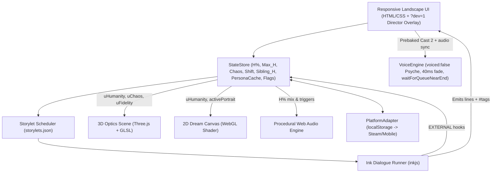

# ARCHITECTURE.md — Pure HTML Engine, Data & Harness Contract

## 1. Architectural Invariants
1. **Pure Static HTML Through Phase 5:** `npm run build` outputs a self-contained static `dist/` bundle runnable in any modern desktop or mobile browser. No Electron or Capacitor dependencies until Phase 6.
2. **Engine vs. Content Isolation:**
   * `src/engine/` — Pure TypeScript systems (Three.js optics, 2D shader canvas, Ink runtime, Storylet scheduler, Web Audio, UI shell, `?dev=1` Director Overlay). Contains **zero** hardcoded narrative prose or balance magic numbers.
   * `src/content/` — Pure data (`balance.json`, `shifts.json`, `characters.json`, `storylets.json`, `anomalies.json`, `dialogue/*.ink`).
   * `src/platform/PlatformAdapter.ts` — Thin ~20-line boundary for persistence (`localStorage` → Steam Cloud/File), achievements (no-op → `steamworks.js`), haptics (no-op → Capacitor), and fullscreen/quit.

## 2. Core Runtime Modules

* **Dialogue & Choice Contract (`DialogueRunner.ts`, `DialogueFeedView.ts`, `VoiceEngine.ts`):**
  * Choices carry structured metadata from Ink tags: `weight` (`explore` | `consequential` | `permanent`), `kind` (`ask` | `reply` | `action` | `prune`), and `costHint` (`# hint:...`), driving color-coded choice plates without exposing Warm/Cold spoiler dots.
  * `VoiceEngine` reads `voice_profiles.json` (`voiced: false` skips unvoiced Psyche marginalia), prefetches audio before engaging `-6 dB` music ducking, applies `40ms` clip fade-outs on `stop()`, inserts `220ms`/`420ms` inter-line pauses, and exposes `waitForQueueNearEnd()` for audio-synced Overseer interrupts.

## 2.5 Content Cohesion, Catalog & Minigame Extension Contracts
1. **`src/content/anomalies.json` (`schema_version: 2`):** Each of the 21 targets extends its optical coordinates with:
   * `scaleClass` (`'planet' | 'star_system' | 'nebula' | 'galaxy' | 'galaxy_cluster' | 'horizon_anomaly'`), `plateId` (`CosmicPlateId`), `preferredVariantIndex` (`0..3`), `distanceLabel`, `actionVerb`.
   * `anomalyRole` (`'baseline' | 'boundary_bleed' | 'direct_anomaly'`), `spoilerFloorShift` (`1..6`).
   * `realCatalogRef`: `{ catalog, designation, raJ2000Deg, decJ2000Deg, distanceLy, sourceLicense }` (commercial-safe only; zero `CC BY-SA`).
   * `preScanBrief`: `{ objective, instrumentAction, whyNow }`.
   * `postScanEcho`: `{ dossierFinding, psycheVoice, psycheLine, storyFlag, unlocksStoryletId }`.
   * `proofContribution`: `{ phase, proofThread, weight }`.
2. **`src/content/shifts.json` (`schema_version: 2`):** Each shift `1..6` defines:
   * `status`: `'implemented' | 'planned'` (gates strict Ink/storylet/VO checks per completed shift while validating all 6 schemas monotonically).
   * `shiftMandate`, `requiredTargets` (length `2`), `optionalTargets` (length `1..2`), and `targetAnomalies` (`[...requiredTargets, ...optionalTargets]`).
   * `skyRevealTier`: `{ catalogLayer, maxMagnitude, starBudget, unlockedSectors, deepFieldPlateIds, constellationGuideAlpha }` (strictly monotonic Shift 1→6).
   * `anomalyPhase`: `{ fractalStage, perceptionLabel, skyShellOpacity, skyShellCoverage, minigameBleedIntensity, dreamCrackBleed }` (strictly monotonic Shift 1→6).
   * `narrativeHooks`: `{ openingKnot, postRequiredKnot, dreamKnot, optionalArchiveEchoId }`.
3. **`src/content/storylets.json` & `StoryletScheduler`:** Storylet preconditions support `minShift`, `maxShift`, `exactShift`, `minAnomalyProgress`, `requiredDecodedTargets`, `minRequiredScansInShift`, `minOptionalScansThisShift`, `minOverseerSuspicion`, `minHumanity`, `maxHumanity`, `requiresFlag`, and `priority`. `StoryletScheduler` and `DialogueRunner` derive `decoded_*` target flags dynamically from `decodedMinigameTargets` + `anomalies.json` (alongside `codexUnlocks`, `completedStorylets`, `prunedPersonas`, and `secondarySiblingFound`) without duplicating a separate `storyFlags` array.
4. **`MinigameRegistry` & `MinigameStateVector` (`src/engine/minigames/`):**
   * `MinigameCatalogEntry` declares `supportedScales: TargetScaleClass[]` and `supportsAnomalyBleed: boolean`, ensuring 1:1 compatibility with `anomalies.json` `scaleClass`.
   * `MinigameStateVector` adds optional `targetScale`, `anomalyRole`, `fractalStage`, and `anomalyBleed` (`0..1`) alongside the 3 Lean Axes (`humanity`, `opticalFidelity`, `chaosDrift` + `shift`).
   * Payout tiers (`balance.json` `minigames.payouts`): `'clean'`, `'deep_overclock'` (Stage-3 Anomaly Overclock capture in Shifts 3–6: bonus Horizon gain at `+Chaos_Drift` and `+Overseer_Suspicion`), and `'partial'`.
5. **Real-Sky Binary Catalog (`assets/astro/star_catalog_10ly.bin`):** Generated by `scripts/build-star-catalog.mjs` from commercial-safe BSC5/Hipparcos-2/Gaia astrometry transformed to the probe's 10.0-ly station offset (`'I14S'` v1 24-byte header with `starCount` + `solDir`, followed by 8-byte quantized records carrying `raQuant`, `decQuant`, `magNorm`, `bvNorm`, `band`, `unlockTier: 1..6`), and registered in `assets/MANIFEST.json`.

## 3. State Schema (`StateStore`)
Core serializable state persisted automatically between beats (`saveSchemaVersion: 7`):
* `shift: number` (`1..6` + finale) & `introStage: 'prologue' | 'title' | 'scan_target_1' | 'mg_1_done' | 'scan_target_2' | 'mg_2_done' | 'complete'`
* `mode: 'boot' | 'waking_3d' | 'dream_2d' | 'ending'`, `runSeed: number`, `activeTargetId: string | null`, `introTarget1Minigame: string`, `introTarget2Minigame: string`
* `humanity: number` (starts `70`, clamped `[0, maxHumanity]`), `maxHumanity: number` (starts `90`, permanently reduced on every prune below `70`)
* `chaosDrift: number` (`0..100`), `subjectiveMonthsLeft: number` (starts `~24`), `opticalFidelity: number`, `anomalyProgress: number` (`0..100`)
* `primarySiblingH: number`, `secondarySiblingFound: boolean`, `overseerSuspicion: number`
* `activeDreamPersonaId: string`, `dreamPersonaCache: string[]`, `prunedPersonas: string[]`
* `scannedAnomalyIds: string[]`, `decodedMinigameTargets: string[]`, `decodedGrades: Record<string, MinigameGradeTier>`, `calibratedInstruments: string[]`, `minigameRunCounts: Record<string, number>`
* `proofFragments: string[]`, `proofDossier: ProofDossierEntry[]`, `completedStorylets: string[]`
* `overseerAuditActive: boolean`, `lastAuditOutcome: AuditOutcome`, `wavelengthNm: number`, `codexUnlocks: string[]`, `codexSeenStages: Record<string, number>`, `inkStateJson: string | null`

## 4. Director Overlay (`?dev=1`)
Enabled whenever the URL includes `?dev=1` (stripped or gated in release builds):
* Jump to any `shift` or `mode` (`boot`, `waking_3d`, `dream_2d`, `ending_1/2/3`).
* Live sliders for `humanity` (0–90%), `chaosDrift` (0–100%), and `opticalFidelity`.
* Buttons to swap active Dream Persona portrait, fire an Overseer Audit Interrupt, or dump JSON telemetry summary.

## 5. Asset & Verification Contracts
* **`assets/MANIFEST.json`:** Every image, texture, star catalog, or audio file under `assets/` must have a matching manifest entry with `path`, `source`, `license` (no `CC BY-SA` or `NC`), `attribution`, and `ai_generated: boolean` (used to auto-render in-game Credits and prepare Steam's AI content survey accurately).
* **`npm run verify`:** Single master gate running strict `tsc`, `.ink` compilation, 500-run economy/storylet simulation, narrative/canon linter, and `MANIFEST.json` coverage check.
