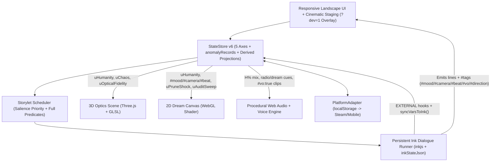

# ARCHITECTURE.md — Pure HTML Engine, Data & Harness Contract

## 1. Architectural Invariants
1. **Pure Static HTML Through Phase 5:** `npm run build` outputs a self-contained static `dist/` bundle runnable in any modern desktop or mobile browser. No Electron or Capacitor dependencies until Phase 6.
2. **Engine vs. Content Isolation:**
   * `src/engine/` — Pure TypeScript systems (Three.js optics, 2D shader canvas, Ink runtime, Storylet scheduler, Web Audio, UI shell, `?dev=1` Director Overlay). Contains **zero** hardcoded narrative prose or balance magic numbers.
   * `src/content/` — Pure data (`balance.json`, `shifts.json`, `characters.json`, `storylets.json`, `anomalies.json`, `voice_profiles.json`, `ui_copy.json`, `dialogue/*.ink`).
   * `src/platform/PlatformAdapter.ts` — Thin boundary for persistence (`localStorage` → Steam Cloud/File), achievements (no-op → `steamworks.js`), haptics (no-op → Capacitor), and fullscreen/quit.
3. **Hands-Off Minigame Isolation:** `src/engine/minigames/games/`, `core/`, and `render/` are owned by the dedicated minigame track. Narrative/engine integration communicates across `MinigameHostView` using neutral middle-ground defaults where extra parameters are expected, and minigames never directly mutate `humanity` (`humanityDelta = 0`).

## 2. Core Runtime Modules

## 3. State Schema (`StateStore` v6 — 5 Orthogonal Axes + Unified Ledger)
Canonical state persisted automatically (`saveSchemaVersion: 6`):
1. **Axis 1 — Identity (`humanity`, `maxHumanity`):** Starts `70 / 90`. Canonical bands in `balance.json:humanityBands` (`warm >= 65`, `mid 45–64`, `cold < 45`). Pruning below `70` permanently clamps `maxHumanity` below `70` (Rubicon ceiling). `opticalFidelity` is derived deterministically from `(humanity, maxHumanity)` (with DevHarness override support preserved).
2. **Axis 2 — Instability (`chaosDrift`, derived/shift-tracked `subjectiveMonthsLeft`, display `hibernationMonthsElapsed`):** Separates real-time hibernation skips from the 24-month subjective waking budget (`monthsPerShift: [3,4,4,4,4,3]`).
3. **Axis 3 — Investigation (`anomalyRecords: Record<targetId, AnomalyRecord>` → derived `anomalyProgress`, `scannedAnomalyIds`, `decodedMinigameTargets`, `decodedGrades`, `proofFragments`, `proofDossier`):** Single normalized ledger projecting backward-compatible read fields.
4. **Axis 4 — Institutional Friction (`overseerSuspicion`, `siblingDesynced`):** Drives Shift 4 forced sibling desync, audit difficulty, and narrative escalation.
5. **Axis 5 — Relational State (`primarySiblingH`, derived `siblingRelation`, `secondarySiblingFound`, `personaSlots`, `workingTheory`, `prologueAnchor`):** Advances `primarySiblingH` per shift using `shifts.json:siblingDriftRange`; projects `dreamPersonaCache` & `prunedPersonas` from `personaSlots`.
* **Persistent Ink Snapshot (`inkStateJson`):** Updated silently via `StateStore.saveInkStateJson()` so save/resume preserves Ink visit counts and once-only choices without recursive UI re-renders.

## 4. Narrative ↔ Minigame Bridge Contract (Light Visual/Informational Coupling)
* **Inbound (`MinigameStateVector`):** Passes `humanity`, `vibeBand`, derived `opticalFidelity`, `shift`, `chaosDrift`, and neutral middle-ground defaults for extended instrument telemetry so minigame fun/solvability remains decoupled.
* **Outbound (`MinigameResult`):** Returns `grade` (`partial | clean | deep_overclock`), optional `proofFragmentId` / `dossierSnippet` / `physicalPrinciple`, and `humanityDelta: 0`.

## 5. Dual-Mode VO, Asset & Verification Contracts
* **Dual-Mode VO Direction Pipeline (`scripts/generate-voices.mjs`):** Parses `# vo:true` and `# direction:...` on every spoken line, always exporting the full casting & acting script (`voice_script.json` + `voice_script.txt`) for online LLMs/voice actors. Supports `--scope=key` (synthesize `# vo:true` key beats) and `--scope=all` (synthesize every line).
* **`assets/MANIFEST.json`:** Every image, font, star catalog, or audio file under `assets/` and `public/voices/` must have a matching commercial-safe manifest entry.
* **`npm run verify`:** Master 8-gate check (`compile-ink`, `tsc --noEmit`, `vitest run`, `sim-playthroughs`, `lint-narrative`, `MANIFEST.json`, `vite build`, `e2e-visual.mjs`).
