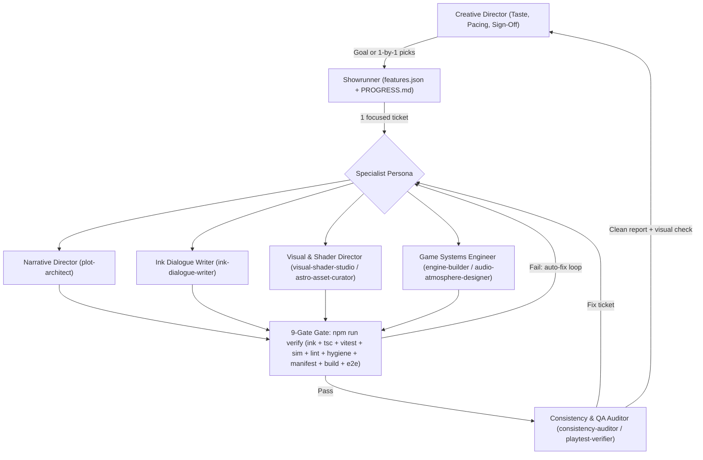

# AI Harness, Agent Personas & Skills Architecture: *Instance-1419*

This blueprint defines the **AI-driven indie game harness** for vibe-coding *Instance-1419* (pure HTML/TypeScript/Three.js + Ink + shaders, Steam-first packaging at the end).

Locked Creative Director rulings governing this harness:
* **Coordinated Overseer Network:** Overseers sync probe wake-ups across the survey shell (multi-probe interferometry, mid-game desynchronization tension, out-of-phase Secondary Sibling).
* **Shift Scan Budget:** **2 required optical scans + 1–2 optional push-your-luck deeper scans per shift** across the 21-instrument sky in `src/content/shifts.json`.
* **Dream Personas:** **8–12 Dream Personas** in the pool, surfacing **4 per playthrough (`2 Fixed Anchors + 2 rotating`)**; downward pruning sacrifices a specific cached persona and permanently drops `Max_H`.
* **Permanently Ambiguous:** Biological volunteer motive and how Sol–Centauri humanity evolved over 41,802 years remain unexplained.
* **Prior 1,417 Copies:** Intimate active waking cast (Primary + optional Secondary Sibling), sprinkled lightly with subtle archived log echoes (`Archive 1406`).
* **Intro Tone & UX Baseline:** Verified intro tone (dry gallows wit + creeping cosmic horror, reserved Cast 2 voices, Layout A + Style 1 & 4 color-coded choice plates) is the canonical bar (`docs/VOICE_GUIDE.md`, `docs/ART_DIRECTION.md`). Keep `docs/IDEAS_LEDGER.md` as optional candidates rather than forcing a comedic shift.

---

## 1. State-of-the-Art Harness Engineering Principles

1. **Map, Not Encyclopedia (`AGENTS.md` + `docs/`):** Keep root `AGENTS.md` `<80` lines as an operating map pointing into Single-Source-of-Truth `docs/` files loaded on demand.
2. **Cross-Session Memory Ledger (`features.json` + `PROGRESS.md`):** Every session reads `PROGRESS.md` + `git log`, works on **one** pending feature in `features.json`, verifies it, and updates both `features.json` and `PROGRESS.md` in the same atomic milestone commit.
3. **Mechanical Enforcement Over Prose Rules:** Critical rules live in `npm run verify` (9 deterministic gates including `lint-narrative`, `check-hygiene`, real-Ink `sim-playthroughs`, and 21-game 3-axis Vitest contracts).
4. **Browser-in-the-Loop Verification (Playwright):** "Compiles cleanly" is never "done" for a game. Verify real DOM/WebGL output in headless Chromium (`npm run test:visual`) across desktop (`1280x720`) and mobile landscape (`844x390`).
5. **Creator vs. Critic Separation:** Agents that write code, prose, or shaders never self-approve a milestone—run `consistency-auditor` and `playtest-verifier` before marking a feature `"passing"`.
6. **Atomic Milestone Commits & Swarm Model Hygiene:** Commit per cohesive milestone (avoid mega-commits bundling unrelated subsystems). When running `/swarm`, reserve the heaviest reasoning model for architecture, prose, and art-direction, and use lighter models for mechanical grep/screenshot passes.

---

## 1.5 Creative Director Taste Compass & 1-by-1 Calibration Protocol

### The 4-Point Taste Compass
1. **Unhurried, meditative pacing with inertia:** Give dialogue room to breathe (`◇` Q&A hubs, 2-line beats); give instruments soft inertial lock-rings and optical aperture cross-dissolves instead of snapping cuts.
2. **Show, don't info-dump or spoil:** Prefer the visual Horizon Arc Ring + Shift Constellation over post-completion trivia walls; color-code choice weight without Warm/Cold spoiler dots; style Psyche interjections as quiet lowercase marginalia.
3. **Reserved, grounded adult craft:** Zero-theatrics Cast 2 voices, curved Zeiss-optical glass over crude primitives or graph-paper grids, dry gallows wit over sitcom pep or sci-fi melodrama.
4. **Narrative cohesion over standalone widgets:** Every minigame, completion moment, audio cue, and telemetry line must serve *Instance-1419*'s cosmic mystery.

### 1-by-1 Taste-Calibration Protocol
Whenever tone, UI feel, voice delivery, or game balance is ambiguous or being newly designed:
1. **Inspect live reality first** (read-only code + rendered screenshots/audio metrics) before proposing changes.
2. **Present concrete options one axis/role at a time** (e.g., A/B/C/D prose takes per character, or one architectural choice per question) so the Creative Director steers by recognition rather than abstract jargon.
3. **Verify in live browser** (`npm run dev`), then record locked rulings in the single canonical SSOT doc below.

---

## 2. Harness Architecture & Daily Vibe-Coding Loop



---

## 3. Single Source of Truth (SSOT) & Repository Layout

Every rule has **exactly one canonical owner document**. Personas and `.agents/skills/*/SKILL.md` **link to** the SSOT owner instead of duplicating CSS selectors, TTS flags, or prose rules verbatim:

| Domain | Canonical SSOT Owner |
| :--- | :--- |
| **Lore, physics, hard boundaries, scan & persona-pool counts** | [`docs/CANON.md`](CANON.md) |
| **2-hour pacing spine, shift beat sheet, persona roster** | [`docs/BEAT_SHEET.md`](BEAT_SHEET.md) |
| **5-role prose tone bible, choice-tag contract, Qwen3-TTS settings** | [`docs/VOICE_GUIDE.md`](VOICE_GUIDE.md) |
| **3D/2D lookdev, Zeiss-glass optics, Layout A & choice-plate UI** | [`docs/ART_DIRECTION.md`](ART_DIRECTION.md) |
| **Engine/Content isolation, 3-Axis contract, VoiceEngine & PlatformAdapter** | [`docs/ARCHITECTURE.md`](ARCHITECTURE.md) |
| **Taste Compass, 1-by-1 calibration, personas, skills, verify gates** | [`docs/HARNESS.md`](HARNESS.md) |

```text
instance-1419/
├── AGENTS.md                        # <80-line operating map, CLI commands & hard boundaries
├── PROGRESS.md                      # Session-to-session handoff log
├── features.json                    # Verifiable milestone/feature ledger (pending/passing)
├── docs/                            # SSOT System of Record (loaded on demand)
├── .agents/
│   ├── personas/                    # 6 lean role mandates pointing to SSOT docs
│   └── skills/                      # 8 modular domain skills pointing to SSOT docs
├── scripts/                         # Deterministic 9-gate verification & generation scripts
│   ├── verify.mjs                   # Master gate: `npm run verify`
│   ├── compile-ink.mjs              # inkjs compiler
│   ├── sim-playthroughs.mjs         # 500-run economy sim + real compiled Ink traversal
│   ├── lint-narrative.mjs           # Canon, word floor/ceiling, choice tags, VO & shift lint
│   ├── check-hygiene.mjs            # Orphaned TS/JSON & retired zombie-architecture guard
│   └── e2e-visual.mjs               # Playwright E2E + visual checks (1280x720 & 844x390)
└── src/
    ├── engine/                      # Three.js optics, 2D dream shader, 21 instruments, Ink, Audio/VO, ?dev=1
    ├── content/                     # shifts.json, anomalies.json, balance.json, characters.json, codex.json, voice_profiles.json, music_catalog.json, dialogue/*.ink
    └── platform/                    # PlatformAdapter.ts (localStorage now -> Electron/Capacitor in Phase 6)
```

---

## 4. The 6 Agent Personas

| Persona | Owns (Write Scope) | Core Mandate | Hard Boundary |
| :--- | :--- | :--- | :--- |
| **1. Showrunner** | `features.json`, `PROGRESS.md`, `AGENTS.md` | Translates direction via 1-by-1 calibration into single-feature tickets, protects 2-hour scope, enforces atomic ledger updates. | Never writes engine code, prose, or shaders directly. |
| **2. Narrative Director** | `CANON.md`, `BEAT_SHEET.md`, `VOICE_GUIDE.md`, `shifts.json`, `storylets.json`, `balance.json` | Architects the 6-shift arc, Overseer desync timeline, 8–12 Dream Persona pool (`2 Fixed + 2 rotating`), `2+optional` scans/shift, and `H%`/Chaos math. | Never explains volunteer motive or human evolution; never writes engine code. |
| **3. Ink Dialogue Writer** | `src/content/dialogue/*.ink` | Drafts grounded, non-abrupt `.ink` scenes honoring `VOICE_GUIDE.md` and `ART_DIRECTION.md` choice tags (`# kind:`, `# weight:`). | Never names loved ones; keeps voiced lines within TTS cadence limits; never alters `balance.json`. |
| **4. Visual & Shader Director** | `ART_DIRECTION.md`, `src/engine/shaders/*`, `characters.json`, `anomalies.json`, `assets/*` | Authors 3D/2D GLSL shaders, swappable Dream Persona oil paintings, Zeiss optics craft, and NASA/ESA `MANIFEST.json` curation. | Must keep 2D portraits swappable via `characters.json` and log 100% of assets in `MANIFEST.json`. |
| **5. Game Systems Engineer** | `src/engine/*`, `src/platform/*`, `src/ui/*` | Builds strict TS runtime systems, Lean 3-Axis instruments, Layout A UI, Web Audio + `VoiceEngine`, `?dev=1`, and `PlatformAdapter`. | Zero hardcoded prose/balance in `src/engine/`; zero Electron/Capacitor until Phase 6. |
| **6. Consistency & QA Auditor** | `docs/audits/*`, `scripts/*` (read-only on `src/`) | **Independent critic.** Runs 9-gate `npm run verify` + Playwright visual checks + qualitative reviews against SSOT docs. | Never silently edits creative work; files line-referenced fix tickets. |

---

## 5. The 8 Modular Skills (`.agents/skills/*/SKILL.md`)

1. **`plot-architect`** — 2-hour pacing (`105–135 min`, `12k–16k` words), `2 required + 1–2 optional` shift scans, `8–12` Dream Personas (`2 Fixed Anchors + 2 rotating`), Overseer desync, `balance.json` & `sim-playthroughs.mjs`.
2. **`ink-dialogue-writer`** — Non-abrupt `.ink` authoring per `docs/VOICE_GUIDE.md`, `◇` Q&A hubs, choice tags (`# kind:`, `# weight:`, `# hint:`), `<=160`-char voiced target (`<=190` hard lint ceiling), `inkjs` compilation.
3. **`visual-shader-studio`** — 3D optics GLSL, 2D `H%` impasto-to-shard decay, Zeiss-glass instrument polish, swappable `characters.json` portraits verified at `H = 90/70/45/20%`.
4. **`astro-asset-curator`** — Commercial-safe NASA/STScI & ESA imagery/catalogs + `assets/MANIFEST.json` hygiene (zero `CC BY-SA` or `NC`).
5. **`audio-atmosphere-designer`** — Procedural Web Audio, Lyria 3.5 hybrid music stems, and Cast 2 Qwen3-TTS pipeline per `docs/VOICE_GUIDE.md` & `docs/ARCHITECTURE.md`.
6. **`engine-builder`** — Pure-HTML TypeScript architecture, Lean 3-Axis `BaseCosmicMinigame`, Layout A & choice-plate UI per `docs/ART_DIRECTION.md`, `PlatformAdapter`, and `?dev=1`.
7. **`consistency-auditor`** — Runs the 9-gate `npm run verify` (`compile-ink`, `tsc`, `vitest`, `sim-playthroughs`, `lint-narrative`, `check-hygiene`, `MANIFEST.json`, `vite build`, `e2e-visual`) + qualitative SSOT audit.
8. **`playtest-verifier`** — Headless Playwright verification (`1280x720` & `844x390`) + 1-click blind playtest telemetry synthesis.
