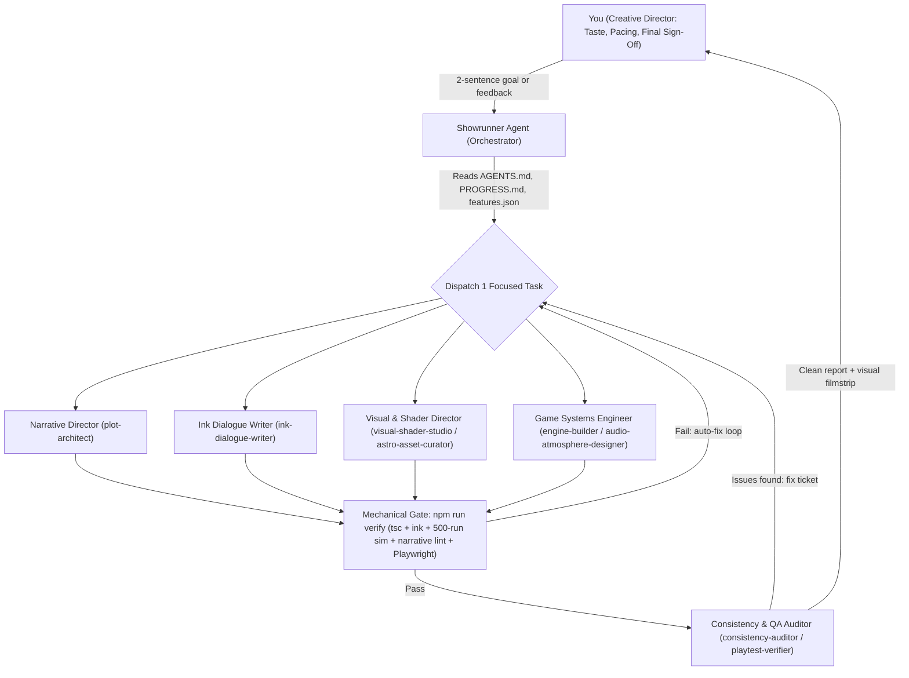

# AI Harness, Agent Personas & Skills Architecture: *Instance-1419*

This blueprint designs a **state-of-the-art AI-driven indie game harness** tailored specifically to vibe-coding *Instance-1419* (pure HTML/TypeScript/Three.js + Ink + shaders, Steam-first packaging at the end).

It locks in your latest plot rulings:
* **Coordinated Overseer Network:** Overseers sync probe wake-ups across the survey shell (enabling multi-probe interferometry, mid-game desynchronization tension, and an out-of-phase Secondary Sibling).
* **Rotating Dream Personas:** Pool of ~10–14 personas, surfacing **3–4 per playthrough** (with pruning tied to sacrificing specific cached personas).
* **Volunteer Mystery:** Stays **permanently ambiguous** (not explored or explained).
* **Prior 1,417 Copies:** Keep active waking cast intimate (Primary + optional Secondary Sibling), sprinkled lightly with **subtle archived log echoes** from earlier decommissioned copies.
* **Dialogue, Choice UX & Reserved Voice Taste (Locked):** Non-abrupt explanatory pacing (~2,000-word intro scale) with optional `◇` Q&A hubs; dry gallows humor + creeping cosmic horror; occasional unvoiced softly styled Psyche marginalia (`· warmth`/`· structure`/`· pattern`); Layout A bottom-anchored feeds with color-coded consequence choice plates (neutral-slate `◇`/explore vs. warm-amber consequential vs. crimson Hold-to-Commit prune, zero Warm/Cold spoiler dots); and reserved, zero-theatrics Cast 2 voices (grounded female Spouse; dry male Sibling 1420 + same male voice on probe tape for Archive 1406; quiet night-shift-doctor male Overseer).

---

## 1. State-of-the-Art Harness Engineering Principles (2025–2026)

Modern agent-first engineering (distilled from OpenAI's *Harness Engineering*, Anthropic's *Effective Harnesses for Long-Running Agents*, and 2026 AI-native indie game workflows) boils down to **five non-negotiable patterns**:

1. **Map, Not Encyclopedia (`AGENTS.md` + `docs/`):** Never dump a 1,000-line prompt into every turn—it causes context rot. Keep root `AGENTS.md` under ~80 lines as an operating map pointing into versioned `docs/` files loaded only when needed.
2. **Cross-Session Memory Ledger (`features.json` + `PROGRESS.md`):** Solves context-window amnesia across weeks of vibe coding. Every session reads `PROGRESS.md` + `git log`, works on **one** verifiable item in `features.json`, verifies it, commits cleanly, and logs handoff notes.
3. **Mechanical Enforcement Over Prose Rules:** Never rely on "please remember not to leak loved-one names or break the economy." Turn critical rules into fast, runnable scripts (`npm run verify`)—every agent mistake becomes a permanent automated check.
4. **Browser-in-the-Loop Verification (Playwright):** "Compiles cleanly" is never "done" for a game. Agents verify UI, Three.js lensing shaders, and 2D `H%` degradation by opening the real HTML app in headless Playwright, scrubbing `?dev=1`, checking console errors, and inspecting screenshots.
5. **Creator vs. Critic Separation:** Agents that write prose, shaders, or engine code never approve their own work. An independent **Consistency & QA Auditor** reviews every milestone against canon, voice, math, originality, and visual regression.

---

## 2. Harness Architecture & Daily Vibe-Coding Loop



---

## 3. Repository & Harness Layout

```text
instance-1419/
├── AGENTS.md                        # <80-line operating map, CLI commands & hard boundaries
├── PROGRESS.md                      # Session-to-session handoff log
├── features.json                    # Verifiable milestone/feature ledger (pending/passing)
├── docs/                            # System of Record (loaded on demand)
│   ├── CANON.md                     # Hard lore facts + explicit "Do Not Touch" boundaries
│   ├── BEAT_SHEET.md                # 2-hour spine (Prologue + 6 Shifts + 3 Endings)
│   ├── VOICE_GUIDE.md               # Stylistic fingerprints for every cast archetype
│   ├── ART_DIRECTION.md             # 3D optics lookdev + 2D impasto-to-shard style guide
│   └── ARCHITECTURE.md              # Engine vs Content vs PlatformAdapter rules
├── .agents/
│   └── skills/                      # 8 modular domain skills (SKILL.md + scripts/templates)
│       ├── plot-architect/
│       ├── ink-dialogue-writer/
│       ├── visual-shader-studio/
│       ├── astro-asset-curator/
│       ├── audio-atmosphere-designer/
│       ├── engine-builder/
│       ├── consistency-auditor/
│       └── playtest-verifier/
├── scripts/                         # Deterministic verification & curation scripts
│   ├── verify.ts                    # Master gate: `npm run verify`
│   ├── sim-playthroughs.ts          # 500-run headless Ink + H%/Chaos economy simulator
│   ├── lint-narrative.ts            # Checks name redaction, word budgets, tags, IP terms
│   ├── fetch-astro-assets.ts        # Commercially safe NASA/ESA/Gaia fetcher + MANIFEST.json
│   └── visual-eval.spec.ts          # Playwright visual filmstrip (desktop 16:9 + mobile 20:9)
└── src/
    ├── engine/                      # Three.js optics, 2D H% shader, Ink runner, Web Audio, ?dev=1
    ├── content/                     # shifts.json, characters.json, storylets.json, balance.json, dialogue/*.ink
    └── platform/                    # PlatformAdapter.ts (localStorage now -> Electron/Capacitor in Phase 6)
```

---

## 4. The 6 Agent Personas

Keep the team lean—**6 clear roles** mirror a real indie studio without multi-agent chatter overhead:

| Persona | Owns (Write Scope) | Core Mandate | Hard Boundary (Cannot Do) |
| :--- | :--- | :--- | :--- |
| **1. Showrunner (Orchestrator)** | `features.json`, `PROGRESS.md`, `AGENTS.md` | Translates your creative direction into single-feature tickets, protects the **2-hour runtime cap**, sequences specialist agents, and enforces clean git checkpoints. | Does not write game code, prose, or shaders directly. |
| **2. Narrative Director** | `docs/CANON.md`, `docs/BEAT_SHEET.md`, `docs/VOICE_GUIDE.md`, `storylets.json`, `balance.json` | Architects the 6-shift mystery arc, coordinated Overseer wake/desync timeline, 10–14 rotating Dream Persona pool (3–4/run + prune choices), subtle 1,417-copy archive echoes, and `H%`/Chaos math. | Never explains the biological volunteer mystery; never writes engine code. |
| **3. Ink Dialogue Writer** | `src/content/dialogue/*.ink` | Drafts crisp, restrained *Disco Elysium*-caliber conversations with inline `H%` adaptation, psyche voices, `# speaker`/`# portrait`/`# audio` tags, and Overseer dream interrupts. | Must stay within shift word budgets and `VOICE_GUIDE.md`; never alters `balance.json` formulas without Narrative Director sign-off. |
| **4. Visual & Shader Director** | `docs/ART_DIRECTION.md`, `src/engine/shaders/`, `src/content/characters.json`, `assets/` | Builds Three.js lensing/spectral/horizon-enclosure shaders, 2D `H%` impasto-to-shard shaders, generates/curates cohesive 2D dream character portraits, and runs NASA/ESA asset curation + `MANIFEST.json`. | Must keep all 2D characters swappable via `characters.json` and log every external asset's license in `MANIFEST.json`. |
| **5. Game Systems Engineer** | `src/engine/`, `src/platform/`, UI/CSS | Builds clean TypeScript modules, responsive landscape UI (desktop + mobile touch parity), Web Audio synth soundscapes, and the `?dev=1` Director Overlay. Keeps packaging out until Phase 6. | Never invents lore, hardcodes dialogue strings, or breaks `PlatformAdapter` isolation. |
| **6. Consistency & QA Auditor** | Read-only + audit reports (`docs/audits/`) | **Independent critic.** Runs `npm run verify`, `sim-playthroughs.ts`, `lint-narrative.ts`, and Playwright visual checks—plus qualitative reviews for lore contradictions, voice drift, pacing bloat, and IP originality. | Never silently edits creative content; files concise, line-referenced fix tickets for the responsible persona. |

---

## 5. The 8 Modular Skills (`SKILL.md` Suite)

Each skill packages exact instructions, checklists, and helper scripts so any agent invoked on that task produces consistent, high-bar output:

### 1. `plot-architect` (Plot, Pacing & Systems Design)
* **Purpose:** Develops and refines the 2-hour narrative arc, Shift 1–6 escalation, coordinated Overseer network events, 1,417-copy subtle archive echoes, and the 10–14 Dream Persona roster.
* **Key Outputs:** `docs/CANON.md`, `docs/BEAT_SHEET.md`, `src/content/storylets.json`, `src/content/balance.json`.
* **Built-In Rules:**
  * Enforces the **2-hour budget** (~12k–16k total words read per playthrough; ~600–900 words per Dream Persona).
  * Guarantees **3–4 personas per run** (1 Prologue Anchor + 2–3 weighted/seeded rotating personas) and pairs downward pruning with sacrificing a specific cached persona.
  * Locks `volunteer_motive = PERMANENTLY_AMBIGUOUS`.

### 2. `ink-dialogue-writer` (Adaptive Dialogue & Character Voices)
* **Purpose:** Writes and refactors `.ink` scenes across all cast archetypes (Spouse/Dream Personas, Overseer AI, Primary/Secondary Siblings, occasional Internal Psyche marginalia, and Archive Echoes).
* **Key Outputs:** Modular `src/content/dialogue/*.ink` files + tag-validated `# speaker`/`# emotion`/`# id` & choice metadata.
* **Built-In Rules:**
  * Reads `docs/VOICE_GUIDE.md` before drafting: fuller non-abrupt beats with optional `◇` Q&A hubs; dry gallows humor + cosmic horror; Spouse (`C+D` uncanny cracks + candid upload honesty); Overseer (`B+D` calm night-shift doctor + eerie 1,417-copy patience); Sibling (`A+C` dry 3 AM deadpan + lucid engineer); Archive (`B` dry note to future self); occasional unvoiced Psyche marginalia (`<=160` chars per voiced line).
  * Tags choices with `# kind:ask|reply|action|prune`, `# weight:explore|consequential|permanent`, and `# hint:<cost>` without forced Warm/Cold spoiler binaries; keeps loved-one names redacted (`[RELATION:*]`).
  * Compiles every `.ink` edit immediately with `inkjs` compiler.

### 3. `visual-shader-studio` (3D Optics Shaders, 2D `H%` Decay & Dream Character Art)
* **Purpose:** Authors custom GLSL shaders (gravitational lensing, spectral wavelength filters, 93-billion-light-year spherical horizon geometry, and 2D impasto-to-shard `H%` degradation) and produces cohesive 2D dream character portraits & tableaus.
* **Key Outputs:** `src/engine/shaders/*.glsl`, `assets/characters/*`, `src/content/characters.json`.
* **Built-In Rules:**
  * Uses a **locked Art Style Sheet (`docs/ART_DIRECTION.md`)** (palette, brushstroke density, lighting, framing) so all 10–14 generated/curated dream characters look painted by the same hand.
  * Every portrait is registered in `characters.json` and previewed across `H = 90%, 70%, 45%, 20%` via Playwright filmstrips.

### 4. `astro-asset-curator` (Public Astronomy Data & Licensing Hygiene)
* **Purpose:** Fetches, crops, color-grades, and WebGL-optimizes real public astronomy assets (NASA/STScI JWST & Hubble imagery, ESA Gaia/Hipparcos star coordinates).
* **Key Outputs:** `assets/astro/*` (WebP/KTX2 + compact JSON starfields) and auto-updated `assets/MANIFEST.json`.
* **Built-In Rules:**
  * Rejects any `CC BY-SA` or non-commercial asset automatically (strictly preserves your clean commercial IP boundary for Steam).
  * Enforces mobile-friendly texture budgets (max 2048px skybox tiles, fast load times for pure HTML playtesting).

### 5. `audio-atmosphere-designer` (Procedural Soundscape, Music & Reserved Cast 2 VO)
* **Purpose:** Builds meditative Web Audio soundscapes (`H%`-reactive dream music, optical detents, clinical Overseer cues) and maintains the reserved Cast 2 Qwen3-TTS voice pipeline (`voice_profiles.json`, `VoiceEngine.ts`).
* **Key Outputs:** `src/engine/AudioEngine.ts`, `src/engine/audio/*`, `src/engine/voice/VoiceEngine.ts`, `src/content/voice_profiles.json`.
* **Built-In Rules:** Reserved, zero-theatrics Cast 2 delivery (`repetitionPenalty: 1.1`, emotion-split anchors, `agate` + two-pass `loudnorm`, no `aecho` slapback, shared biological-original male voice for 1420 & 1406, `"voiced": false` Psyche, `40ms` stop fade-out, audio-synced Overseer interrupts via `waitForQueueNearEnd()`); handles browser autoplay unlock cleanly.

### 6. `engine-builder` (Pure HTML/TS Core, UI & Director Overlay)
* **Purpose:** Implements Three.js scenes, 2D dream canvas, `inkjs` runtime + Storylet Scheduler, Layout A dialogue & Color-Coded Choice Plates UI, responsive landscape UI, `PlatformAdapter`, and the `?dev=1` Director Overlay.
* **Key Outputs:** Strict TypeScript modules in `src/engine/`, `src/platform/`, and `src/ui/`.
* **Built-In Rules:** Zero hardcoded dialogue/balance values; Layout A bottom-anchored dialogue + Style 1 & 4 color-coded choice plates (no `.choice-affinity-dot`, Hold-to-Commit prune, turn-grouping, spoiler-free Kitchen Prologue, `1–6`/`↑↓`/`Enter`); touch targets ≥44px and legible at `844×390` and `1920×1080`.

### 7. `consistency-auditor` (Automated Linting + Deep Continuity Review)
* **Purpose:** The immune system of the project. Combines deterministic scripts with structured qualitative audits.
* **Automated Checks (`npm run verify`):**
  1. **TypeScript & Ink Compile:** Zero type errors, zero broken Ink knots/variables/external calls.
  2. **500-Run Playthrough Simulator (`sim-playthroughs.ts`):** Runs Pure Pruner, Pure Humanist, Balanced, Indecisive, and Random bots from Prologue to Credits—asserts zero soft-locks, permanent `Max_H` ceiling drops work, and all 3 Endings are reachable.
  3. **Narrative & Canon Linter (`lint-narrative.ts`):** Flags any accidental loved-one proper names, missing `# speaker`/`# portrait` tags, orphaned `characters.json` entries, per-shift word-count overruns, and accidental IP overlap terms (e.g., *Lena* proper nouns).
  4. **License Manifest Check:** Every file in `assets/` has a verified commercial-safe entry in `MANIFEST.json`.
* **Qualitative Review Pass (Per Milestone):** Audits voice fidelity (night-shift-doctor Overseer, dry 3 AM Sibling, uncanny-cracked Spouse, occasional unvoiced Psyche, Cast 2 biological-original consistency between 1420 & 1406), non-abrupt pacing with `◇` Q&A depth, color-coded choice hierarchy (zero Warm/Cold spoiler dots), and subtle 1,417-copy continuity.

### 8. `playtest-verifier` (Playwright Visual & End-to-End QA + Human Telemetry)
* **Purpose:** Drives the real pure-HTML build in headless Chromium via Playwright to catch what unit tests miss—WebGL errors, dialogue chasms, choice-plate regressions, overlapping text on mobile landscape, unreadable fonts, broken shader uniforms, or dead buttons.
* **Key Outputs:**
  * Visual regression filmstrip (`artifacts/visual-check/`): 3D lensing view, clinical boot log, and 2D Dream at `H = 90%, 70%, 45%, 20%` on both **1920×1080** and **844×390 (mobile landscape)**.
  * Human Playtest Analyzer: Parses testers' 1-click end-of-run JSON telemetry summaries (shift durations, `H%` trajectories, ending distribution, Secondary Sibling discovery rate) into concrete pacing recommendations.

---

## 6. How We Can Bootstrap This Right Now

You don't need external tooling to run this harness—we can instantiate it directly in your workspace (and register reusable skills + subagent personas) in **one clean bootstrap step**:

1. **Bootstrap the Harness Foundation (Day 1):** Create `AGENTS.md`, `PROGRESS.md`, `features.json`, `docs/CANON.md` (seeded from [ORIGINAL_CONCEPT.md](./ORIGINAL_CONCEPT.md) + all decisions from our chat), `docs/VOICE_GUIDE.md`, and the 8 `.agents/skills/*/SKILL.md` files.
2. **Run Milestone 1 (`plot-architect` + `consistency-auditor`):** Lock `docs/BEAT_SHEET.md`, the 10–14 Dream Persona roster, `balance.json`, and the runnable `sim-playthroughs.ts` simulator.
3. **Run Milestone 2 (`engine-builder` + `visual-shader-studio` + `playtest-verifier`):** Scaffold the pure HTML Vite + Three.js + `inkjs` app with `?dev=1` and run your first live visual + dialogue verification in browser.
