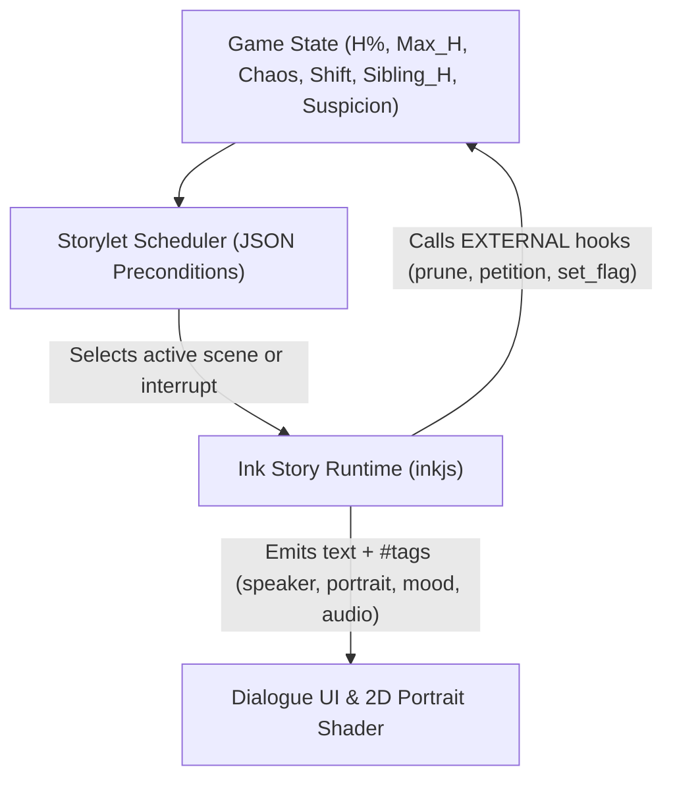
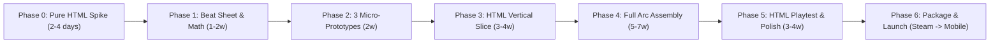

# Vibe-Coded Production Playbook: *Instance-1419*

This roadmap adapts [ORIGINAL_CONCEPT.md](./ORIGINAL_CONCEPT.md) to your exact constraints:
* **Workflow:** Vibe-coding first (AI-assisted coding, shaders, asset curation/creation, and iteration; your role is Creative Director, Editor, and Playtester).
* **Release Order:** **Steam-first** (paid indie release, €1–€2+ range), followed by **Mobile (Landscape)** from the same codebase.
* **Data & Assets:** Commercially safe public astronomy datasets + shader-driven visuals.
* **Scope:** Tight **2-hour** single-arc experience (~6–7 shifts).

---

## 1. Locked Tech Stack: Why Web/TS Beats Godot for Vibe Coding

Although the original concept doc leaned toward Godot 4, **vibe coding flips the recommendation cleanly to an HTML/TypeScript stack**:

| Dimension | Why Web / TypeScript Wins for Vibe Coding |
| :--- | :--- |
| **100% Plain-Text Project** | Zero binary `.tscn`/`.tres` scene files, Inspector clicking, or broken node-path wiring. Everything is TypeScript, GLSL, CSS, and JSON/Ink—areas where AI coding models are at their peak. |
| **Instant Feedback Loop** | Hot-reload in the browser in milliseconds. Share a preview build or test on your phone over local Wi-Fi without recompiling native SDKs. |
| **Native Narrative & Clinical UI** | Half of *Instance-1419* is *Disco Elysium*-style dialogue, nameless family tags, and sterile boot logs. HTML/CSS produces sharper typography and responsive landscape layouts with a fraction of the effort. |
| **Automated Verification** | AI agents can run `tsc`, automated playthrough simulators, and headless Playwright screenshots to catch visual or narrative bugs before you even look. |
| **Clean Steam & Mobile Packaging** | Wrap the exact same Vite web build in **Electron + `steamworks.js`** for Steam (Windows/Linux/Steam Deck/macOS), and later **Capacitor** for iOS/Android. |

### Recommended Concrete Stack
* **Core App:** `Vite` + `TypeScript` (strict mode) + lightweight UI (`React` or `Svelte` — React/Tailwind has the deepest vibe-coding fluency).
* **3D Waking Cosmos:** `Three.js` + custom GLSL shaders (gravitational lensing, spectral wavelength filters, 93-billion-light-year spherical horizon leaks).
* **2D Painterly Dreams:** Layered HTML Canvas / WebGL shader quad driven directly by `H%` (impasto brushwork → cold thinned lines → fragmented shards) + crisp CSS dialogue overlay.
* **Narrative Engine:** **`inkjs`** (Inkle's narrative scripting language) or clean typed JSON state graphs—keeps 15,000 words of branching dialogue cleanly separated from engine code.
* **Audio:** **Web Audio API / Tone.js** (procedural probe hum, optical ticks, sterile Overseer chimes) + small curated CC0 ambient stems.
* **Desktop / Steam Wrapper:** **Electron** + `steamworks.js` (proven Steam Overlay, Cloud Saves, Achievements, and Steam Deck compatibility).
* **Mobile Wrapper (Post-Steam):** **Capacitor** (landscape lock, safe-area insets, native haptics).

---

## 2. Commercial, Licensing & Steam Policy Checklist

Because you plan to charge €1–€2 on Steam while using public data and AI-assisted creation, settle three legal/storefront rules upfront so there are zero surprises at launch:

1. **Public Astronomy Data (Commercial-Safe Hygiene):**
   * **NASA / STScI (JWST & NASA Hubble imagery):** Public domain (US Govt) — safe for commercial games; include a courtesy credit and do not imply NASA endorsement.
   * **ESA / Hubble / Webb ESA releases & Gaia data:** Generally **CC BY 4.0 / CC BY 3.0 IGO** — safe for commercial use with attribution in your Credits screen.
   * **Avoid CC BY-SA datasets** (e.g., some derivative star catalogs) so you maintain the same clean IP boundary noted for *Lena* in [ORIGINAL_CONCEPT.md](./ORIGINAL_CONCEPT.md).
   * *Vibe-coding win:* Keep a single `assets/MANIFEST.json` where every fetched texture/catalog logs its source URL and license, and auto-render the in-game Credits screen from that manifest.
2. **Steam AI Content Disclosure Policy:**
   * Steam permits AI-assisted code and pre-generated AI assets, **provided** you disclose pre-generated AI art/audio/text in Steam's Content Survey (which adds an informational disclosure box to your store page) and respect copyright.
   * *Asset-Agnostic 2D Strategy (Decide Later):* Build the 2D dream renderer around **swappable character/tableau asset slots** (`characterId` + `mood` → texture + `H%` shader). Generate draft painterly dream characters during prototyping, then decide before Steam submission whether to ship finalized AI-generated portraits (with Steam's standard disclosure) or swap in non-AI/composited art—zero engine rewrite either way.
3. **Steam Direct & Pricing Note (€1–€2):**
   * Steam charges a **\$100 recoupable app fee** per game (returned once the game earns \$1,000 gross).
   * Charging €1–€2 is totally fine as a passion project; just know that on Steam, **€2.99–€4.99** (with a launch discount to €1.99–€2.99) often converts *better* than €0.99 because buyers associate sub-€2 prices with low-effort shovelware. You can decide final pricing after seeing playtester reactions to your Vertical Slice.

---

## 3. Dialogue, Character & Portrait Architecture

Because *Instance-1419* features a small, deeply reactive cast whose tone, visuals, and relationship to you evolve with `H%`, Chaos Drift, and shift progress, use a **Hybrid Storylet + Ink (`inkjs`)** dialogue system:



### Why Hybrid Storylet (JSON) + Ink (`inkjs`) Fits *Instance-1419*
* **Outer Layer — JSON Storylet Scheduler:** Cleanly decides *which* encounter fires next based on typed state rules (e.g., *"In Shift 3, if Player `H%` > Sibling `H%` + 15, queue the One-Sided Grief transmission"* or *"If `Overseer_Suspicion` >= 2 during Dream 2, inject Audit Interrupt"*).
* **Inner Layer — Ink Scripts (`*.ink`):** Handles the actual branching prose cleanly—readable like a screenplay, effortless to vibe-code and hand-edit, with built-in inline `H%` text variations, memory of past lines, and **tunnels/interrupts** (ideal for the Overseer breaking unannounced into a dream).

### Mapping Your Four Character Archetypes

| Cast Role | Where They Appear | How Dialogue & Visuals Adapt |
| :--- | :--- | :--- |
| **Other "Me" (Primary & Secondary Siblings)** | 3D Waking Shifts (comms feed / stylized signal portrait) | Tracks `sibling_h` independently of `player_h`. Computes `sibling_delta = player_h - sibling_h` to branch smoothly between *Shared Humor*, *One-Sided Grief*, *Eerie Sync*, or *Role Reversal*. |
| **Overseer AI** | Unannounced interrupts inside 2D Dreams | Uses Ink interrupt knots triggered by `overseer_suspicion` or `chaos_drift`. Evaluates audit responses to either enforce pruning or grant upward memory-unsealing petitions (`70% → 90%`). |
| **Dream Personas (Nameless Loved Ones)** | 2D Painterly Dreams | Portrait texture + GLSL shader automatically read live `H%` (warm impasto at ≥75% → cold thinned lines at 50% → abstract shards at ≤30%). Names stay permanently sanitized via tags like `[RELATION:SIBLING_01]`. |
| **Internal Psyche Voices** | Both Modes (heaviest in 2D Dreams) | 2–3 distinct inner voices (e.g., *Clinical Connectome*, *Residual Warmth*, *Horizon Pattern*) whose interjections unlock or fade automatically based on current `H%` and `chaos_drift`. |

### Example: What One Adaptive Beat Looks Like in Ink
```ink
# bg:dream_table # speaker:phantom_family # portrait:family_01 # mood:warm
{
  - humanity >= 75:
    "[RELATION:PARTNER] laughs—almost clear enough to catch the syllable of their name before it dissolves."
  - humanity >= 45:
    "[RELATION:PARTNER] tilts their head. The warmth is still there, thinned like paint stretched too far."
  - else:
    "Entity [RELATION:PARTNER] executes a facial geometry consistent with affection. No name record found."
}

{ humanity >= 65:
  # speaker:psyche_warmth
  Hold onto the cadence. Don't let the probe compress this too.
}

{ overseer_suspicion >= 2:
  -> overseer_dream_audit_interrupt
}

* [Reach for the missing name (+Chaos, Petition memory)]
    ~ shift_chaos(8)
    -> reach_for_name
* [Flag emotional residue for pruning (-10% H, -10% Max H, +Optical Fidelity)]
    ~ prune_humanity(10)
    -> accept_prune
```

* **Swappable Portrait Contract:** Every `# speaker:` + `# portrait:` tag resolves through a single `src/content/characters.json` registry mapping to image paths + shader presets—so generating or replacing 2D character portraits later never touches any script or game logic.

---

## 4. Five Guardrails for Successful Vibe Coding

Most vibe-coded games stall around Week 4 when the codebase tangles and every prompt breaks something else. Bake these 5 guardrails into the repo on Day 1:

1. **Strict Separation of Engine vs. Data:**
   * `src/engine/` holds reusable systems (`StateStore`, `OpticsScene`, `DreamScene`, `AudioEngine`, `DialogueRunner`).
   * `src/content/` holds pure data (`shifts.json`, `characters.json`, `storylets.json`, `anomalies.json`, `balance.json`, `dialogue/*.ink`).
   * `src/platform/PlatformAdapter.ts` is a tiny ~20-line interface for saves, achievements, and quit/fullscreen (backed by `localStorage` in pure HTML during Phases 0–5, then swapped cleanly to Electron/Steamworks or Capacitor in Phase 6).
2. **A Built-In Director Overlay (`?dev=1`):**
   * Always-accessible debug bar to: jump to any Shift, drag a live `H%` slider (0–100%), toggle Chaos Drift, trigger an Overseer Audit, or preview all 3 Endings. Lets you direct aesthetics and feel in seconds per iteration.
3. **Automated Playthrough & Balance Simulator (`npm run sim`):**
   * A headless Node script that compiles your `.ink` files and runs your real `StateStore` + Storylet Scheduler across 500+ simulated runs (*Pure Pruner*, *Pure Humanist*, *Balanced*, *Random*) to guarantee zero broken flags, zero soft-locks, and reachable endings after every edit.
4. **Automated Visual Checkpoints (Playwright):**
   * One command captures screenshots of key views (3D lensing view, boot log, 2D dream at `H=90%`, `70%`, `35%`, plus 16:9 desktop and 20:9 mobile landscape) so AI edits can be verified visually without manual click-throughs.
5. **Living Context Docs (`docs/`):**
   * Keep 4 short, authoritative markdown files in the repo (`CONCEPT.md`, `ARCHITECTURE.md`, `BEAT_SHEET.md`, `VOICE_GUIDE.md`) so every vibe-coding session stays locked onto the exact tone, lore, and code boundaries.

---

## 5. Stage-Gated Process (Pure HTML Through Phase 5 → Package in Phase 6)



*(Staying 100% pure static HTML through Phase 5 removes all native build friction—every milestone is a single static folder you can open locally or share as a private URL for desktop and mobile browser playtesting.)*

### Phase 0: Pure HTML Scaffold & 48-Hour Tech Spike (2–4 Days)
* **Goal:** Prove the vibe-coding loop and dual-reality rendering in pure HTML before designing details.
* **Vibe-coded deliverables:**
  * Initialize Vite + TypeScript + Three.js + Tailwind + `inkjs` + stub `PlatformAdapter` (`localStorage`).
  * Build a throwaway spike: 1 NASA deep-field skybox + 1 interactive gravitational-lens shader + transition to 1 painterly canvas with an `H%` degradation slider + 1 Ink dialogue panel.
  * Verify `npm run build` produces a self-contained static `dist/` folder that opens smoothly on desktop browsers **and** mobile landscape browsers.
* **Exit Gate:** You can go from prompt → playable browser visual change in under 30 seconds with zero wrapper overhead.

### Phase 1: Concept Refinement & Systems Spine (1–2 Weeks)
* **Goal:** Turn [ORIGINAL_CONCEPT.md](./ORIGINAL_CONCEPT.md) into structured data specs that an AI can build cleanly.
* **Deliverables:**
  1. **2-Hour Beat Sheet (`docs/BEAT_SHEET.md`):** Lock **Prologue + 6 Shifts + Finale** (~15–18 min/shift, ~12k–16k total words):
     * *Prologue (10m):* Warm 2D family moment → clinical boot log (41,802 yrs / 1,417 copies) → 3D void.
     * *Shift 1 (15m):* Learn Optics Tool 1, meet Primary Sibling (comic relief), first Dream + Overseer Audit.
     * *Shift 2 (18m):* First impossible geometric leak at the horizon, Optics Tool 2, first `H%` dilemma.
     * *Shift 3 (18m):* Primary Sibling begins pruning; optional discovery of Secondary Sibling; Overseer flags early drift.
     * *Shift 4 (20m):* Combine tools to map curvature; major Prune vs. Petition Overseer pivot; stark `H%` dream degradation.
     * *Shift 5 (20m):* Confirm the 93-billion-light-year enclosure centered on Sol–Centauri; Primary Sibling relationship climax; high-stakes Overseer Audit.
     * *Shift 6 / Finale (15–20m):* Final push under Chaos Drift → transmit signal → one of the 3 Ending Spectrum outcomes.
  2. **3 Tactile Observation Mechanics:** Narrow the open-ended suite to 3 interlocking shader-friendly tools:
     * *Gravitational Lensing Alignment* (pan/orbit aperture to bring Einstein arcs into geometric clarity).
     * *Spectral Band Tuning* (sweep wavelengths to isolate unnatural geometric leaks from natural dust/stars).
     * *Horizon Arc Unwarping* (map aligned leaks onto the celestial sphere to reveal the Earth-centered enclosure).
  3. **Executable Economy Spec (`src/content/balance.json` + `npm run sim`):** Verify starting `H = 70%`, permanent `Max_H` drops when pruning, Overseer petition thresholds (`70% → 90%`), Chaos Drift decay, and ~2-year subjective lifespan math.
  4. **Voice & Tone Guide (`docs/VOICE_GUIDE.md`):** 1-page style sheet defining the voices of Instance-1419's psyche, the dry-humored Primary Sibling, the quirky Secondary Sibling, nameless family tags, and the chillingly banal Overseer AI—critical so AI-assisted draft prose never sounds generic or melodramatic.

### Phase 2: Three Ugly Micro-Prototypes (2 Weeks)
* **Goal:** Validate *feel* and *vibe* in the browser before producing content.
* **Deliverables (using the `?dev=1` Director Overlay):**
  1. **Optics Feel Sandbox:** Test Lensing Alignment + Spectral Tuning with mouse AND phone touch. Iterate shader responsiveness, subtle Web Audio feedback, and cursor/drag inertia until sweeping the cosmos feels genuinely meditative.
  2. **Dream Audit Sandbox:** Play one 5-minute *Disco Elysium*-inspired Ink dream sequence where the Overseer interrupts unannounced. Tune typography, pacing, choice clarity, and emotional tension.
  3. **Visual Contrast & `H%` Shader Sandbox:** Perfect the hard cut (warm 2D → harsh monospace boot log → photorealistic 3D) and calibrate the `H%` shader across 90% / 70% / 45% / 20%.
* **Exit Gate:** Share a private HTML link with 3–5 friends/devs. Cut or simplify any mechanic that feels like homework.

### Phase 3: Pure HTML Vertical Slice (3–4 Weeks)
* **Goal:** Build **Prologue + Shift 1** (~15–20 minutes) to ship quality as a playable web build.
* **Deliverables:**
  * Scripted NASA/ESA/Gaia asset curation pipeline + `assets/MANIFEST.json` auto-credits.
  * Swappable 2D character/tableau slots (`characters.json`) + `H%` shader pipeline for Dream 1.
  * Complete Web Audio soundscape pass (probe hum, optical clicks, Overseer tones, warm dream ambience).
  * Full save/resume via `PlatformAdapter` (`localStorage`) + responsive 16:9 / ultrawide / landscape-mobile layout.
* **Exit Gate:** 5–10 blind playtesters play the private HTML link (itch.io password-protected / Netlify / GitHub Pages) without coaching. Verify runtime extrapolation (~2 hours total) and emotional hook.

### Phase 4: Full Arc Production — Skeleton First (5–7 Weeks)
* **Pass 1 — Playable Greybox Start-to-Finish (Weeks 1–2):**
  * Wire all 6 Shifts, Sibling branches, Overseer audits, and all 3 Endings with rough draft `.ink` scripts and placeholder vistas.
  * Run `npm run sim` + play the full 2-hour loop yourself in-browser to check mystery pacing and emotional curve.
* **Pass 2 — Prose & Reactivity Polish (Weeks 2–4):**
  * Draft shift-by-shift using `VOICE_GUIDE.md`, then **personally edit every scene**—human editorial taste is what elevates an indie narrative game from "AI-written" to unforgettable.
  * Ensure Primary Sibling divergence (`H%` mirroring) hits hard and Secondary Sibling discovery rewards curious observers.
* **Pass 3 — Cosmic Escalation, Dream Art & Audio (Weeks 4–7):**
  * Curate/author remaining deep-field targets leading up to the 93-billion-light-year spherical reveal.
  * Finalize the remaining ~5–6 core dream tableaus/character portraits and `H%`-reactive audio layers.

### Phase 5: Pure HTML Blind Playtesting & 2-Hour Calibration (3–4 Weeks)
* Run **2 waves of 10–15 blind testers** via a private HTML link (zero download barrier = much higher tester completion rates!).
* Add an optional end-of-run copyable JSON telemetry summary (shift durations, `H%` curve, ending reached, stuck points) so testers can paste feedback in 1 click.
* Trim ruthlessly so median playtime lands cleanly at **1.75–2.25 hours** with zero pacing valleys.
* Final polish pass on transitions, audio mixing, font readability, and WebGL shader performance on both desktop and mobile browsers.

### Phase 6: Packaging & Release (Steam First → Mobile Port)
Only once the 2-hour HTML game is locked, playtested, and polished do you touch native packaging:
1. **Steam Wrapper (1–2 Weeks):**
   * Wrap the finished static `dist/` build in **Electron + `steamworks.js`**.
   * Implement the Steam `PlatformAdapter` (Steam Cloud saves, 6–8 subtle story/ending achievements, clean Quit/Fullscreen, Steam Deck controller/trackpad defaults).
   * Launch your Steam "Coming Soon" page + export the Prologue/Shift 1 branch as a free **Steam Next Fest Demo** (optional, strongly recommended for wishlists).
2. **Steam Launch:** Ship on Steam with auto-generated NASA/ESA attribution credits and Week-1 patch support.
3. **Mobile Port (1–2 Weeks Post-Steam):** Wrap the same `dist/` build with **Capacitor**, swap in the Mobile `PlatformAdapter` (haptics, safe-area insets, landscape lock), test thermals on real phones, and ship to iOS / Android.

---

## Recommended Starting Action

Because you want to vibe-code efficiently from Day 1, the highest-leverage next step is **either**:
1. **Phase 0 Scaffold:** Spin up the minimal Vite + TypeScript + Three.js + `inkjs` + Director Overlay (`?dev=1`) project structure right here so you can immediately feel the 3D gravitational-lens shader and 2D `H%` degradation shader in action, **or**
2. **Phase 1 Beat Sheet & Economy:** Draft `docs/BEAT_SHEET.md` + `docs/VOICE_GUIDE.md` + `balance.json` (with the automated playthrough simulator) so every shift and ending is mathematically and narratively airtight before writing game code.
